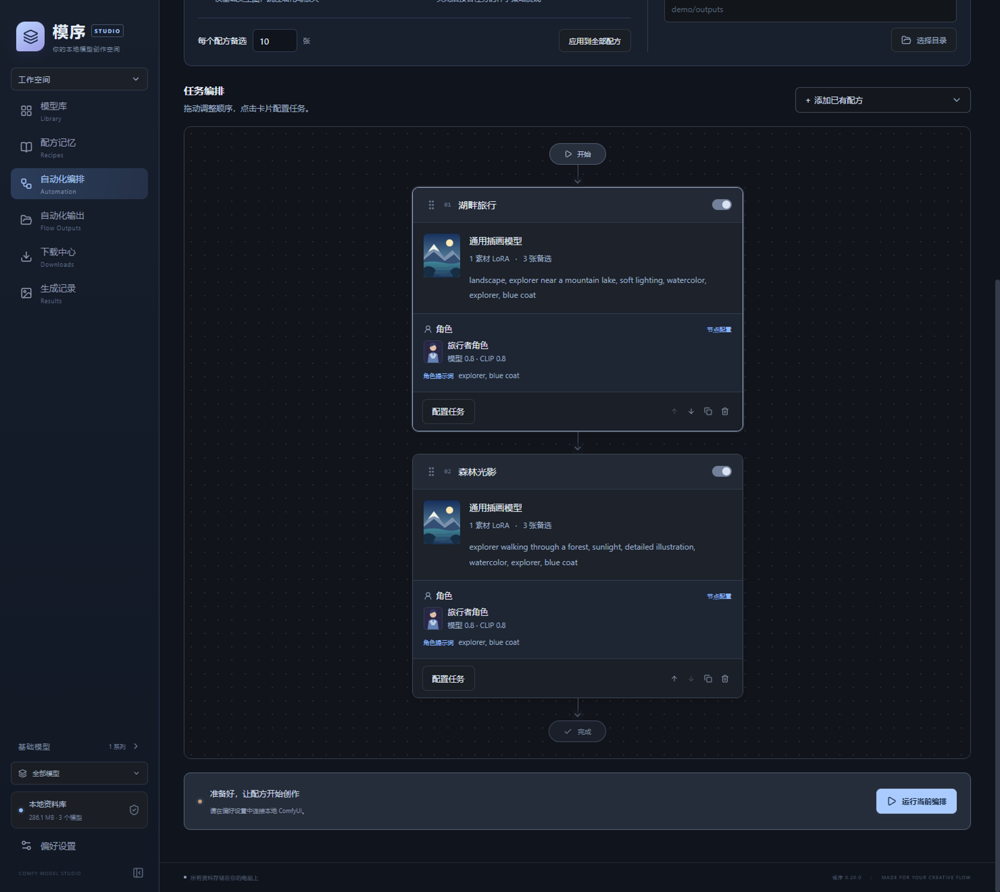
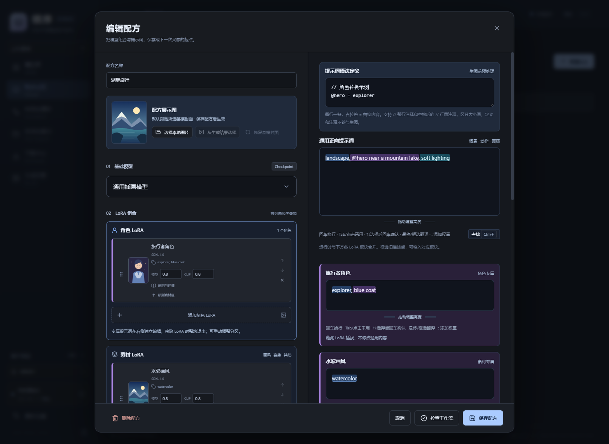

# 模序 · Comfy Model Studio

Windows 上的本地 ComfyUI 模型资料库、配方管理与批量生成工具。当前版本 **0.23.0**，无需浏览器扩展。

## 使用前准备

**请按顺序操作：先下载并运行秋叶 ComfyUI → 获取自己的 Civitai API Key → 再下载模序 → 完成连接与目录配置 → 开始下载模型和生成图片。**

模序配合本机秋叶 ComfyUI 使用，负责模型管理、配方与任务编排；实际生图由 ComfyUI 执行。本项目不附带 ComfyUI、模型或 API Key。

## 第一步：先下载秋叶 ComfyUI

1. 打开秋葉aaaki 的[官方下载导航](https://www.bilibili.com/opus/897873624905547794)，找到 ComfyUI 整合包；也可参考作者的 [ComfyUI 发布与使用教程](https://www.bilibili.com/video/BV1Ew411776J/)。下载入口及更新说明以作者页面为准。
2. 下载适合自己显卡的整合包，按作者说明完整解压并启动。
3. 确认浏览器能够打开 ComfyUI，建议先在 ComfyUI 中完成一次基础文生图。
4. 记下 ComfyUI 服务地址，默认通常为 `http://127.0.0.1:8188`。后续使用模序生成图片时，保持 ComfyUI 运行。

## 第二步：获取 Civitai API Key

1. 注册并登录自己的 Civitai 账号，打开[账号设置](https://civitai.com/user/account)。
2. 找到 **API Keys**，点击 **Add API key**，创建并复制自己的密钥。
3. 暂时妥善保存，启动模序后填入偏好设置。不要把密钥发到 Issue、截图或公开文件中。

API Key 用于访问需要认证的模型下载资源，下载权限取决于账号和资源本身。如果在模序中选择其他模型来源，请在对应站点获取并配置匹配的密钥。

## 第三步：再下载模序

完成前两步后，打开 [模序最新版下载页](https://github.com/tuanzirwar/ComfyModelStudio/releases/latest)，在 **Assets** 中选择：

- **便携 EXE**：下载文件名以 `portable.exe` 结尾的程序，双击运行，无需安装 Node.js。
- **ZIP**：下载 Windows x64 压缩包，完整解压后运行 `win-unpacked/模序.exe`，请保留同目录的资源文件。

## 第四步：首次配置

1. 保持秋叶 ComfyUI 运行，打开模序的 **偏好设置**。
2. 在 **ComfyUI 安装目录** 中选择实际包含 `models` 等目录的 ComfyUI 文件夹，不要选到整合包最外层或启动器所在目录。
3. 填写 ComfyUI 服务地址，点击 **检测连接**。
4. 在 **Civitai 连接** 中选择模型来源，粘贴自己的 API Key，点击 **保存密钥**。
5. 核对各类模型的存放目录和自动化输出目录，点击 **保存设置**。

## 第五步：开始使用

1. 扫描已有模型，或在下载中心通过模型页面链接下载所需的基模与 LoRA。
2. 创建配方，选择基模、LoRA、提示词和图片参数，先进行快速预览。
3. 将配方加入自动化编排，设置顺序与备选数量，再启动生成。
4. 在自动化输出中挑选要保留的图片，填写图片集名称后保存。


## 分享与加载配方

在配方卡片点击 **分享配方**，预览后保存为 .recipe.json 文件，再把文件分享给其他人。

在配方记忆页点击 **加载配方**，选择分享文件，核对本机模型后保存。程序优先按 SHA256 或同一发行文件匹配；只有名称相同的文件需要手动选择确认。没有对应 LoRA 时，可从模型来源下载后再加载，或明确选择跳过；基模必须选择。

加载会创建独立配方，同名时自动编号。分享文件包含提示词、语法、LoRA 权重、采样参数与公开模型来源，不包含模型本体、密钥、私人备注、展示图、本机目录或自定义工作流。接收方使用自己的默认工作流与基模封面，必要时请在加载后编辑工作流并检查绑定。

## 功能

- 模型缩略图、基础模型与版本分组、自定义标签、收藏和使用频率排序。
- 模型资料与作者说明保存；并发下载、暂停续传、哈希校验及重复文件复用。
- 保存、复制和编辑配方，选择自己的效果展示图。
- 通用提示词与各 LoRA 触发词分区管理；全局角色可替换全部编排节点。
- 拖动编排顺序，设置备选数量、分辨率、采样参数和输出目录。
- 显示当前采样进度，保留原始输出；筛选图片、建立图片集并按编排顺序编号。
- 框内提示词补全、中文释义、权重补全、Ctrl+F 查找及可调编辑区域。
- 三套可切换主题。

未填写编排名时，批次名称自动使用时间戳与启用节点名称。

## 界面预览

以下截图使用虚构示例资料与示意封面。





## 提示词语法

在语法区每行填写一个替换规则：

```text
// 角色与服装
@hero = explorer
@outfit = blue coat
```

正文可写 `@hero near a lake, @outfit`，运行前统一替换。通用提示词框内按 Ctrl+F 查找，Enter 下一处，Shift+Enter 上一处，Esc 退出。

内置中英词条数量有限，未收录的提示词可能无法补全或翻译。

## 隐私

程序不附带模型、账号、密钥、私人配方或生成记录。请使用自己的模型与凭据。API Key 在本机加密保存，资料库保存在 Windows 应用数据目录。不要将个人资料目录分享给他人。详见 [安全与隐私](SECURITY.md)。

## 授权

当前尚未指定开源许可证。第三方依赖保留各自许可证。
